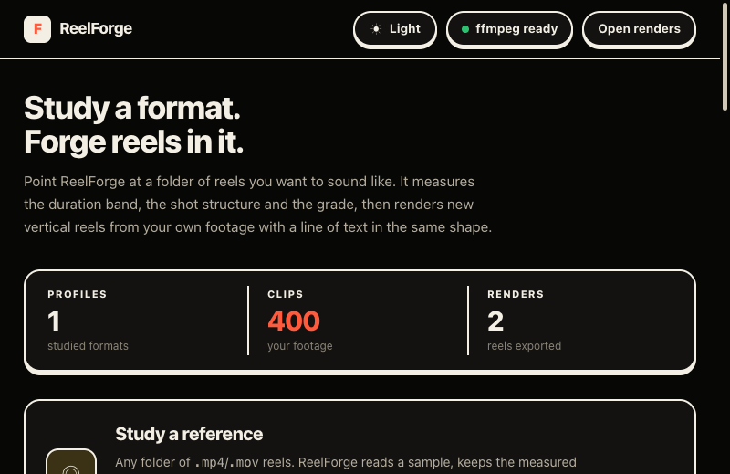

# ReelForge

Study a reel format, then forge new reels in it.

Point ReelForge at a folder of reels whose *format* you want to work in. It
measures the format — duration band, shot structure, grade — then renders new
9:16 reels from **your own footage** with a single line of text in the same
shape: same pacing, same crushed grade, same upper-third text block.

Everything runs locally on `ffmpeg`, in one stdlib Python process. No account, no
upload, no telemetry.

**Live demo (UI only):** <https://kartbala07.github.io/ReelForge/> — the real studio with a
studied profile and two reels this pipeline rendered. Rendering itself needs ffmpeg and your
own clips, so it runs locally.



## What "same format" means here

Measured from a 1,000-reel reference set (`docs/style-profile.md` has the full
methodology):

| property | measured | what the renderer does |
| --- | --- | --- |
| canvas | 1080×1920 (9:16) | crops any source to 1080×1920 |
| duration | median **6.7 s**, p25 6.6 / p75 6.9, max 8.1 | picks inside the p25–p75 band per reel |
| shots | **0 cuts** at scene threshold 0.10 — one continuous take | no montage; one clip per reel |
| luma | mean **YAVG 37** / 255 | grade solved per clip until the output measures the same |
| colour | **SATAVG 2.8** (near-monochrome), teal shadows | eq + colour balance + slight highlight warmth |
| text | pale-yellow lowercase sans, 4–5 lines, centred, upper third | `drawtext`, per-line centred, fades in over 0.6 s |
| audio | present on 100% of references | keeps the clip's own audio, or takes a track |

The grade is not a fixed filter: ReelForge measures the source clip, solves
brightness + saturation for it, renders, **measures the output**, and re-encodes
once if the luma is still more than 3 off the profile. So a bright daylight clip
comes out at the reference luma instead of pretending it was already dark.

## Install

Needs Python 3.9+ and `ffmpeg` on `PATH`. Nothing else — no pip install.

```bash
git clone https://github.com/KartBala07/ReelForge.git
cd ReelForge
python3 server.py --open        # http://127.0.0.1:8792
```

## Use

1. **Study a reference.** Paste a folder of reels and hit *Study*. You get a
   profile card with the measured numbers (canvas, duration, single-shot,
   luma, saturation). Nothing is uploaded; only numbers are stored, in
   `~/.reelforge/profiles/<name>.json`.
2. **Add your footage.** Any folder of `.mp4`/`.mov`. Vertical or landscape.
3. **Generate lines.** The text engine writes one line per reel (themes:
   `longing`, `late-night`, `self-worth`, `crush`, `heartbreak`, `nostalgia`).
   Every line is editable, and the line breaks are what renders — so you control
   exactly where each line breaks.
4. **Render.** Watch the log stream; the reel appears in the grid with its
   measured match (`Δluma +1.2`).

Renders land in `~/.reelforge/renders/`.

### Without the UI

```bash
# 1. study a folder once
python3 -c "from reelforge import style; style.save(style.study('~/refs/account'), '~/.reelforge/profiles/account.json')"

# 2. render N reels from a clip folder
python3 -m reelforge.render_cli \
  --profile ~/.reelforge/profiles/account.json \
  --source-dir ~/Movies/clips \
  --out-dir ~/Movies/reels \
  --count 5 --topic late-night
```

`render_cli` prints `RENDERED <file>` / `FAILED <file> <reason>` per reel, so it
drops straight into cron:

```cron
0 19 * * * cd ~/ReelForge && python3 -m reelforge.render_cli --profile ~/.reelforge/profiles/account.json --source-dir ~/Movies/clips --out-dir ~/Movies/reels --count 2
```

### Fetching a reference set

ReelForge does not scrape. It studies a folder you already have — for example a
ReelVault library (`~/.reelvault/data/<account>/`), which downloads an account's
reels with your own browser session. Scrape with ReelVault, then point ReelForge
at that folder.

## How it works

```
web/                  the UI (same design system as ReelVault)
server.py             stdlib HTTP: JSON API, SSE job log, Range video
reelforge/
  probe.py            ffmpeg -i parsing (no ffprobe), scene cuts, colour stats
  style.py            study() → profile; the look, as numbers
  lines.py            text engine: frames + word banks, optional local LLM
  render.py           filter graph, per-clip grade calibration, match check
  render_cli.py       batch renderer (the "bot"), machine-readable output
  jobs.py             one render subprocess per job, log ring + SSE
  store.py            SQLite: sources, jobs, renders
```

The filter chain, in order:

```
trim → scale/crop 9:16 → tone curve → eq (per-clip luma/sat)
→ colour balance → 3–6% push → grain → vignette → deband → drawtext → yuv420p
```

The push exists because the reference format is one continuous handheld shot: a
perfectly static frame reads as a still, and 4–6% over the clip reads as "alive"
without becoming a montage.

## On copying

Use reference footage to **measure a format**, not to publish. ReelForge stores
only numbers from the reference set — no frames, no audio, no captions — and the
renderer only ever touches clips you point it at. Publishing someone else's
footage or sound is a copyright problem and against Instagram's terms; publishing
your own footage in a studied *format* is not.

The default line engine writes original lines from its own frames and word banks;
it never copies reference captions.

## License

MIT — see [LICENSE](LICENSE).
